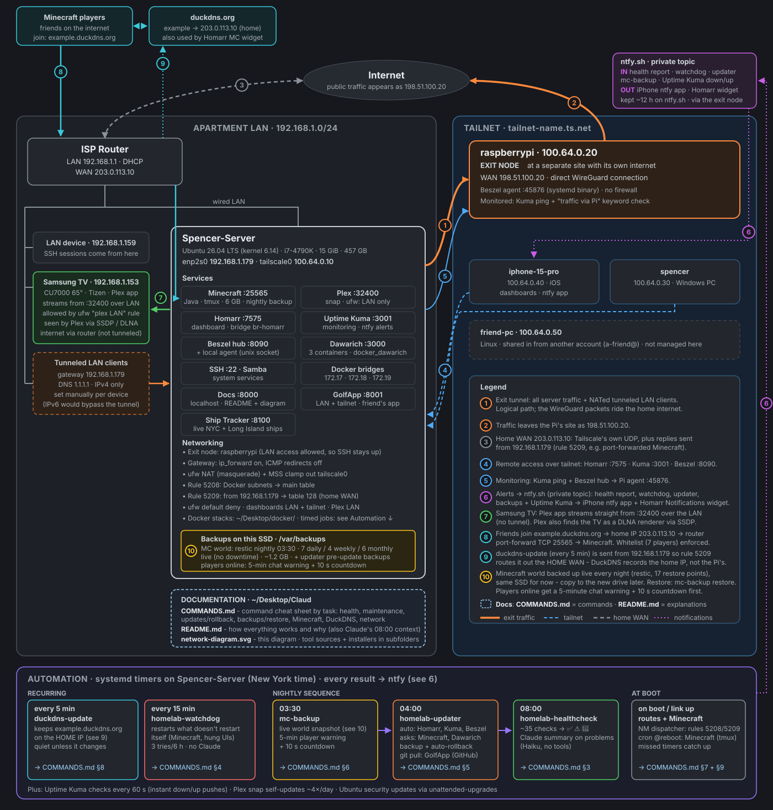

# Homelab: Spencer-Server

A self-hosted home server on Ubuntu, running Docker services, a Minecraft server and Plex, joined to a Tailscale network. I wrote the automation to keep it healthy, updated and backed up without daily attention. The setup, scripts and documentation were built with [Claude Code](https://claude.com/claude-code) as a pair-programming and ops assistant.

## What it runs

| Service | What it does |
|---|---|
| **Homarr** | Main dashboard: service tiles, Uptime Kuma status, system stats, notifications |
| **Uptime Kuma** | Up/down monitoring for every service, with phone alerts |
| **Beszel** | CPU, RAM, temperature, disk and network graphs |
| **Dawarich** | Self-hosted location history (3 containers: app with built-in job worker, PostGIS, Redis) |
| **Minecraft server** | Java server for friends, reachable through a DuckDNS address |
| **Plex** | Media streaming to the TV and other devices on the LAN |
| **Web app hosting** | A friend's golf web app served to the LAN and tailnet for testing |

**Networking:** the server is on a Tailscale tailnet with a Raspberry Pi exit node. Policy routing sends the server's own traffic through the Pi while keeping Minecraft and DuckDNS on the home connection. A ufw firewall defaults to deny, and the dashboards are reachable only from the LAN and tailnet. Details are in [SERVER.md §4](SERVER.md).

## Automation I built

All of these are bash scripts with systemd timers, each with its own `install.sh`.

| When | Tool | What it does |
|---|---|---|
| Every 5 min | [`duckdns/`](duckdns/) | Keeps the Minecraft DNS name pointed at the home IP, even though the server's traffic goes out through the exit node |
| Every 15 min | [`healthcheck/homelab-watchdog`](healthcheck/) | Restarts crashed services, with a retry limit and push alerts |
| 03:30 nightly | [`mc-backup/`](mc-backup/) | Live, deduplicated Minecraft world backups with restic: warns online players, pauses saving, then restores it. One-command restore. |
| 04:00 nightly | [`updater/`](updater/) | Auto-updates the low-risk containers after a backup, verifies health, and **rolls back automatically** if an update breaks something. Higher-risk apps get an "update available" alert instead. |
| 08:00 daily | [`healthcheck/homelab-healthcheck`](healthcheck/) | Checks disk, RAM, temperature, SMART, failed units, containers, web UIs, VPN routing, DNS and backups, then sends a ✅/⚠️/🚨 report to my phone via ntfy |

## Repository layout

| Path | Contents |
|---|---|
| [`SERVER.md`](SERVER.md) | Full documentation: services, traffic flow, firewall, troubleshooting table, open to-dos |
| [`COMMANDS.md`](COMMANDS.md) | Command cheat sheet grouped by task |
| [`network-diagram.svg`](network-diagram.svg) | Hand-built SVG of the network, services and automation |
| [`UPGRADE-26.04.md`](UPGRADE-26.04.md) | Step-by-step plan for the Ubuntu 25.04 → 26.04 LTS upgrade |
| `healthcheck/` `updater/` `mc-backup/` `duckdns/` | The automation tools above: scripts, systemd units and installers |
| `docs-server/` `golf-server/` | Small systemd web servers (docs viewer, web app host) |
| [`docker/`](docker/) | Docker Compose files for Homarr, Uptime Kuma, Beszel and Dawarich (secrets live in `.env` files, which are not in this repo) |
| [`minecraft/`](minecraft/) | Minecraft start scripts |

## Tech

Ubuntu Linux · Docker Compose · systemd services and timers · Bash · Python · Tailscale · ufw/iptables policy routing · restic · ntfy · Uptime Kuma · PostgreSQL/PostGIS

## Note

IP addresses, domain names and account names in this public copy are placeholders. Passwords, API keys and the ntfy topic were never stored in these files: they live in root-only config files on the server.
